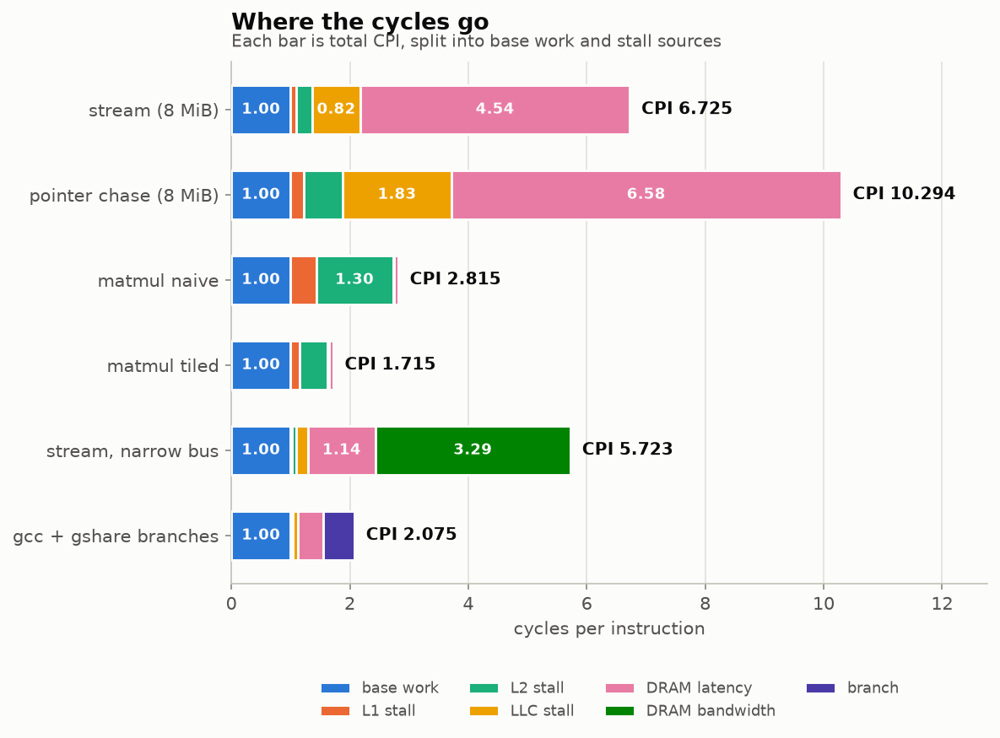
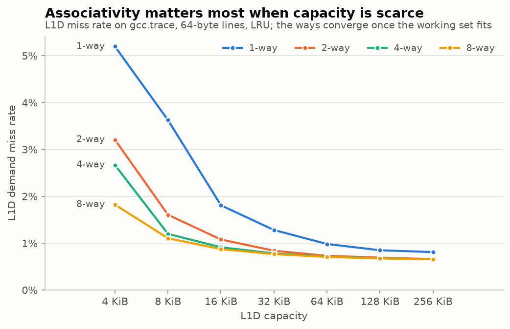
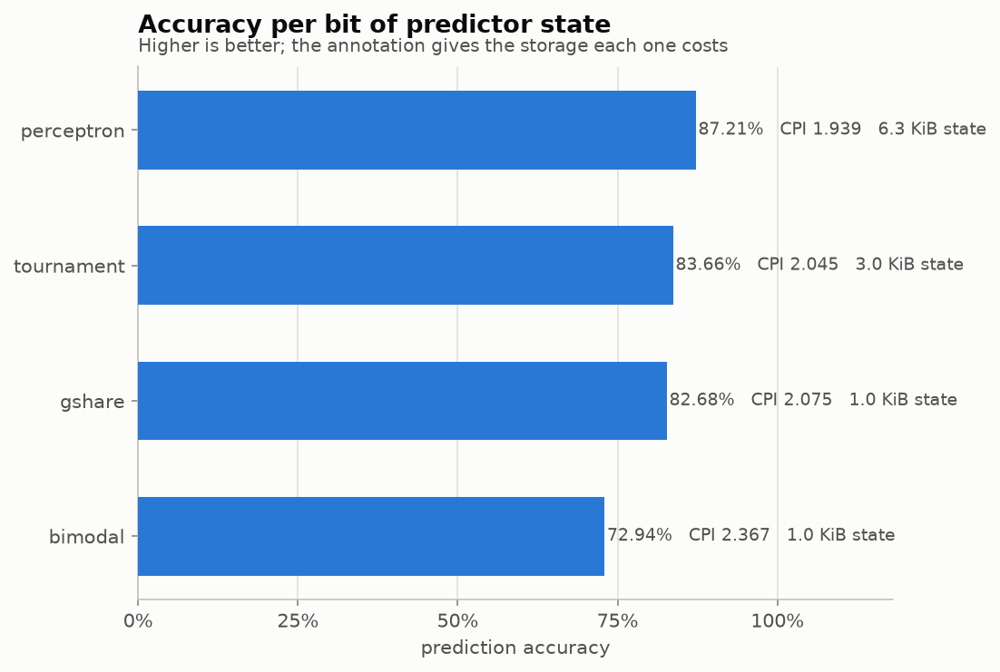
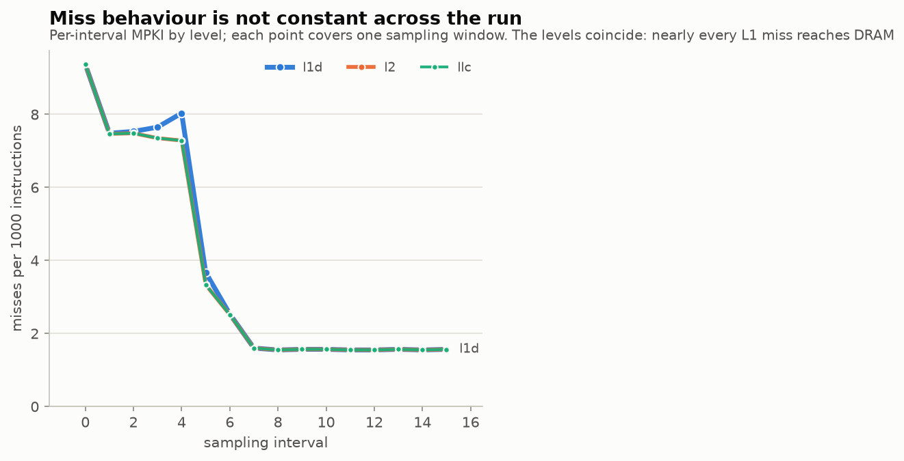

# cachescope

A trace-driven CPU memory-hierarchy and branch-prediction simulator with
PMU-style telemetry, written in C++17.

It exists to answer one question — **why is this workload slow?** — by walking
all the way down from a wall-clock-style number (estimated CPI) to the low-level
counters that explain it (per-level misses, MPKI, DRAM bandwidth, mispredicts),
and then saying so in a sentence:

```
Diagnosis: Memory-bound: DRAM bandwidth 100.0% utilized during phase 2 of 11
  - Stalls account for 82.5% of cycles; base work is 17.5%.
  - DRAM bandwidth queueing: 57.5% of cycles (38072375 cycles)
  - DRAM latency stalls: 19.8% of cycles (13136200 cycles)
```

Every number in this README came from an actual run in this repository. Nothing
is estimated, extrapolated or illustrative. Where something could not be
measured on the development machine, it says so.

---

## Contents

- [What it does](#what-it-does)
- [Architecture](#architecture)
- [Quick start](#quick-start)
- [Configuration](#configuration)
- [Telemetry](#telemetry)
- [Validation](#validation)
- [Analysis and dashboard](#analysis-and-dashboard)
- [MCP server](#mcp-server-ai-in-the-lab)
- [RESULTS](#results)
- [Roadmap](#roadmap)
- [Project layout](#project-layout)
- [Credits](#credits)

---

## What it does

**Memory hierarchy.** One to three configurable levels (L1D, L2, optional LLC),
each with its own size, associativity, block size, hit latency, write policy
(write-back / write-through), allocation policy (write-allocate /
no-write-allocate) and replacement policy (LRU / FIFO / random). Inclusive and
non-inclusive hierarchies are both modelled, including back-invalidation of
inner copies when an inclusive LLC evicts.

**Prefetchers.** Next-line and a constant-stride detector, configurable per
level by degree, distance, table size and confidence threshold.

**DRAM.** Fixed latency plus a bandwidth ceiling with real queueing, so a
workload that saturates the bus shows unbounded and growing queue delay instead
of a constant latency. This is what lets the simulator tell *bandwidth-bound*
apart from *latency-bound* rather than lumping both into "memory-bound".

**Branch prediction.** Bimodal, gshare, tournament (bimodal + gshare with a
chooser) and a Jiménez–Lin perceptron predictor, all with configurable table and
history sizes, and all reporting their storage cost so comparisons can be made
at equal budget.

**Telemetry.** PMU-style counters with stable names (`l1d.loads`, `l2.misses`,
`llc.mpki`, `dram.bytes_read`, `dram.bw_utilization`, `branch.mispredicts`, …),
sampled every N accesses into CSV and JSON Lines so the result is a time series
and phase behaviour is visible.

**Top-down summary.** An exact decomposition of every simulated cycle into base
work, L1/L2/LLC stalls, DRAM latency, DRAM bandwidth queueing and branch
mispredicts, plus a plain-English verdict.

---

## Architecture

```
                 memory trace                        branch trace
          "l 0x1fffff50 4" per line            "0x400100 t" per line
                     |                                   |
                     v                                   v
          +---------------------+              +--------------------+
          |   MemTraceReader    |              | BranchTraceReader  |
          | buffered, no iostream|             +--------------------+
          +----------+----------+                        |
                     |                                   v
                     |                      +---------------------------+
                     |                      | BranchPredictor           |
                     |                      |  bimodal | gshare         |
                     |                      |  tournament | perceptron  |
                     |                      +-------------+-------------+
                     |                                    | mispredict rate
                     v                                    |
        +------------------------------------------+      |
        |              Hierarchy                   |      |
        |                                          |      |
        |   +--------+   miss   +--------+  miss   |      |
        |   |  L1D   |--------->|   L2   |-------->|      |
        |   | Cache  |<---------| Cache  |<--------|      |
        |   +---+----+ writeback+---+----+ wb      |      |
        |       |                   |              |      |
        |   Replacement         Prefetcher         |      |
        |   LRU/FIFO/rand       next-line/stride   |      |
        |       |                   |              |      |
        |       +---------+---------+              |      |
        |                 v                        |      |
        |            +---------+   miss            |      |
        |            |   LLC   |------------------>|      |
        |            +---------+                   |      |
        +--------------------+---------------------+      |
                             | fill / writeback            |
                             v                             |
                   +---------------------+                 |
                   |        DRAM         |                 |
                   | fixed latency +     |                 |
                   | bandwidth ceiling   |                 |
                   | with queueing       |                 |
                   +----------+----------+                 |
                              |                            |
                              v                            v
                   +------------------------------------------------+
                   |                    Engine                      |
                   |  instructions, cycles, CPI, AMAT               |
                   |  cycle attribution -> CycleBreakdown           |
                   +----------------+-------------------------------+
                                    |
                     +--------------+---------------+
                     v                              v
             +---------------+            +--------------------+
             |   Telemetry   |            |  TopDownReport     |
             | CSV + JSONL   |            |  buckets + verdict |
             | every N access|            +--------------------+
             +---------------+
```

**Request flow for one demand access.** Walk inward-to-outward until a level
hits, charging each traversed hit latency. If every level misses, go to DRAM.
Then fill the levels that missed *outermost first*, so a line evicted from an
inner level lands in a level that already holds its successor. Route dirty
evictions outward; under inclusion, back-invalidate inner copies.

Writebacks and write-through traffic never add to demand latency (a store buffer
absorbs them) but they **do** consume DRAM bandwidth, so they create queueing for
later demand reads. That is the mechanism by which a write-heavy workload becomes
bandwidth-bound.

**Stall attribution rule.** An L1 hit is treated as fully pipelined and costs
nothing. Any access that misses L1 exposes every latency it then traverses,
including the wasted L1 lookup. The buckets are an exact decomposition: they sum
to the reported cycle count, and a unit test asserts it.

---

## Quick start

```bash
# 1. Build (no third-party dependencies; GoogleTest is fetched only for tests)
cmake -S . -B build -DCMAKE_BUILD_TYPE=Release
cmake --build build --parallel

# 2. Get the upstream traces
scripts/fetch_traces.sh

# 3. Run
./build/cachescope run -c configs/baseline.json -t traces/upstream/swim.trace
```

```
cachescope: baseline-3level
========================================================================
trace records         303193
instructions          909579
cycles               1781143
CPI                   1.9582   (IPC 0.5107)
AMAT                  6.8279 cycles

level      accesses       misses      miss%       MPKI   writebacks
l1d          303193         3541      1.17%      3.893         2736
l2             3541         3453     97.51%      3.796           29
llc            3453         3453    100.00%      3.796            0

DRAM  requests 3453  read 220992 B  write 0 B  bw 1.6%  avg queue 0.00 cyc

Top-down cycle breakdown
------------------------------------------------------------------------
base work               51.07%         909579  ####################
L1 stall                 0.80%          14164
L2 stall                 2.39%          42492  #
LLC stall                6.98%         124308  ###
DRAM latency            38.77%         690600  ################
DRAM bandwidth queue     0.00%              0
branch mispredict        0.00%              0

Diagnosis: Memory-bound on DRAM latency: 38.8% of cycles waiting at 200-cycle
memory latency, LLC MPKI 3.80
```

### Other commands

```bash
# Interval telemetry as CSV + JSON Lines, plus a full JSON summary
./build/cachescope run -c configs/baseline.json -t traces/upstream/gcc.trace \
    --interval 25000 --csv out.csv --jsonl out.jsonl --json summary.json

# Override any config field without editing a file
./build/cachescope run -t traces/upstream/gcc.trace \
    --set levels.1.size_kb=1024 --set levels.0.replacement=fifo

# Compare all four branch predictors on one trace
python3 scripts/gen_branch_trace.py --pattern mixed --count 200000 \
    --out traces/branch/sample.trace
./build/cachescope branch -t traces/branch/sample.trace --compare

# Print the effective configuration (defaults resolved, overrides applied)
./build/cachescope config -c configs/baseline.json --set dram.bytes_per_cycle=4
```

---

## Configuration

JSON, with `//` and `/* */` comments accepted. Any field can be overridden on
the command line with `--set <dotted.path>=<value>`, which is also what the
sweep tool and the MCP server use.

```json
{
  "name": "baseline-3level",
  "third_field": "size",
  "inclusion": "non-inclusive",
  "levels": [
    { "name": "l1d", "size_kb": 32,   "assoc": 8,  "block_size": 64,
      "hit_latency": 4,  "write_policy": "write-back",
      "alloc_policy": "write-allocate", "replacement": "lru",
      "prefetcher": { "kind": "next-line", "degree": 1, "distance": 1 } },
    { "name": "l2",  "size_kb": 256,  "assoc": 8,  "block_size": 64, "hit_latency": 12 },
    { "name": "llc", "size_kb": 2048, "assoc": 16, "block_size": 64, "hit_latency": 36 }
  ],
  "dram":    { "latency_cycles": 200, "bytes_per_cycle": 8.0, "queue_capacity": 64 },
  "timing":  { "base_cpi": 1.0, "instructions_per_access": 3.0,
               "branch_mispredict_penalty": 15, "mlp_overlap": 0.0 },
  "branch":  { "predictor": "gshare", "pc_index_bits": 12, "history_bits": 12,
               "density": 0.2 },
  "telemetry": { "interval_accesses": 25000, "csv_path": "", "jsonl_path": "" }
}
```

Level names double as counter prefixes, so a level called `l2` produces
`l2.misses`, `l2.mpki` and so on. Configuration is validated up front with
specific errors rather than silent coercion:

```
$ ./build/cachescope run -t traces/upstream/gcc.trace --set levels.0.size_kb=3
cachescope: level 'l1d': size_bytes (3072) must be a non-zero multiple of
assoc*block_size (512)
```

### Two knobs worth understanding

**`mlp_overlap`** is the fraction of post-L1 latency hidden by overlapping
misses. At the default `0.0` the core is fully blocking: only one demand miss is
ever outstanding, so it *cannot* saturate memory bandwidth no matter how narrow
the bus. Memory-level parallelism is what creates bandwidth pressure, and this
is the knob that supplies it. The effect is visible in
[RESULTS](#bandwidth-bound-versus-latency-bound).

**`branch.density`** is the fraction of instructions that are conditional
branches. A branch trace and a memory trace are separate files describing
separate instruction streams, so they cannot simply be stepped together. Instead
the branch trace yields a mispredict *rate* — a property of the predictor on that
trace — and density converts it into a cycle cost against the memory workload:

```
branch_stall = instructions * density * mispredict_rate * penalty
```

### The trace format, and its third field

cachescope reads the format used by
[kev-kim/cache-simulator](https://github.com/kev-kim/cache-simulator):

```
l 0x1fffff50 4
s 0x1fffff58 1
```

The upstream simulator **ignores the third field entirely**
(`csim_fns.cpp:261`). In `gcc.trace` that field is `0` on 42% of lines, with a
mean of 1.99 and a maximum of 74 — which rules out a byte count, and fits
"non-memory instructions executed since the previous access". Rather than pick
one reading silently, both are available:

| `--third-field` | meaning | instruction count |
|---|---|---|
| `size` (default) | bytes touched; used to report line-crossing accesses | `accesses * instructions_per_access` |
| `instr_gap` | non-memory instructions since the previous access | **exact, from the trace** |
| `ignore` | parsed and discarded | `accesses * instructions_per_access` |

Traces captured by `scripts/capture_valgrind.sh` always carry a measured
instruction count, so they should be run with `--third-field instr_gap`.

---

## Telemetry

Every `interval_accesses` accesses, the full counter set is appended to the CSV
and JSONL sinks. Counters are **monotonic**, exactly like a real PMU, with a few
`interval.*` deltas alongside for convenience:

```
sim.cpi, sim.ipc, sim.amat, sim.instructions, sim.accesses, sim.cycles
l1d.loads, l1d.stores, l1d.hits, l1d.misses, l1d.miss_rate, l1d.mpki,
l1d.dirty_evictions, l1d.back_invalidations, l1d.prefetch.useful, l1d.occupancy
l2.*, llc.*            (same shape, prefixed by level name)
dram.reads, dram.writes, dram.bytes_read, dram.bytes_written,
dram.bw_utilization, dram.avg_queue_delay, dram.max_queue_depth
branch.branches, branch.mispredicts, branch.accuracy, branch.mpki,
branch.cpi_contribution, branch.predictor_state_bits
topdown.base_pct, topdown.l1_stall_pct, ... topdown.branch_pct
interval.cpi, interval.dram_bw_utilization, interval.llc_mpki
```

---

## Validation

Three independent checks, all runnable.

### 1. Differential against the upstream simulator

The strongest correctness evidence here. cachescope is configured to match an
upstream geometry exactly and both are run on the same trace; all six
load/store hit and miss counters must agree exactly.

```bash
git clone --depth 1 https://github.com/kev-kim/cache-simulator.git /tmp/upstream
make -C /tmp/upstream
python3 scripts/validate_upstream.py --csim /tmp/upstream/csim \
    --cachescope build/cachescope --traces traces/upstream
```

```
56/56 configurations match upstream exactly
```

7 traces × 8 geometries, covering direct-mapped, 4-way, 8-way and fully
associative; LRU and FIFO; and all three write-policy combinations. Full table
in [`docs/upstream_validation.md`](docs/upstream_validation.md). This runs in CI
and gates the build.

### 2. Unit tests with hand-computed expectations

```bash
ctest --test-dir build --output-on-failure
```

```
136 tests from 20 test suites ran.
[  PASSED  ] 136 tests.
```

Every replacement policy, write policy, prefetcher and predictor is covered by
tests whose expected values were computed by hand on tiny traces. For example,
the classic LRU/FIFO discriminator — access A, B, A, C on a 2-way set — must
leave `{A, C}` under LRU and `{B, C}` under FIFO, and a separate test asserts the
two policies genuinely diverge on identical input.

### 3. Against real hardware

`scripts/capture_valgrind.sh` traces the `bench/` microbenchmarks with Valgrind
lackey; `scripts/run_perf.sh` measures the *same binaries and arguments* under
`perf stat`; `scripts/compare_perf.py` joins the two. Both read their workload
list from `scripts/workloads.tsv`, because a simulated-versus-measured table is
meaningless if the two sides ran different problem sizes.

See [RESULTS](#simulated-versus-measured) and
[`docs/perf_comparison.md`](docs/perf_comparison.md).

---

## Analysis and dashboard

```bash
pip install -r requirements.txt

# Parameter sweep -> results CSV
python3 scripts/sweep.py --cachescope build/cachescope \
    --config configs/baseline.json --trace traces/upstream/gcc.trace \
    --sweep levels.0.size_kb=4,8,16,32,64,128,256 \
    --sweep levels.0.assoc=1,2,4,8 \
    --out analysis/sweep_l1_gcc.csv

# Figures (light and dark, plus a CSV of the exact plotted numbers)
python3 scripts/analyze.py --sweep-l1 analysis/sweep_l1_gcc.csv \
    --telemetry analysis/telemetry_swim.csv \
    --cpi-stack analysis/cpi_stack_inputs.csv \
    --predictors analysis/sweep_predictor.csv \
    --outdir analysis/figures

# Interactive dashboard
streamlit run dashboard/app.py
```

<picture>
  <source media="(prefers-color-scheme: dark)" srcset="analysis/figures/cpi_stack_dark.png">
  
</picture>

<picture>
  <source media="(prefers-color-scheme: dark)" srcset="analysis/figures/miss_rate_vs_size_dark.png">
  
</picture>

<picture>
  <source media="(prefers-color-scheme: dark)" srcset="analysis/figures/predictor_accuracy_dark.png">
  
</picture>

<picture>
  <source media="(prefers-color-scheme: dark)" srcset="analysis/figures/mpki_over_time_dark.png">
  
</picture>

---

## MCP server (AI in the lab)

```bash
pip install -e mcp/
CACHESCOPE_BIN=build/cachescope cachescope-mcp
```

Tools: `run_simulation`, `sweep`, `get_counters`, `diagnose`, `list_traces`,
`list_configs`. Runs are cached and keyed by a hash of the full invocation, so
an agent that asks the same question twice pays once. Errors come back as
structured values rather than exceptions — a sweep point with an invalid
geometry is useful information about the design space, not a failure.

### Example agent prompt, and its actual run

> **"Find the smallest L2 that keeps CPI within 5% of a 1 MB L2 on swim.trace."**

This is a real transcript, reproducible with
`PYTHONPATH=mcp python3 -c` against the tools:

```
### step 1: discover traces
   available: ['gcc', 'read01', 'read02', 'read03', 'sample', 'swim', ...]

### step 2: reference run, 1 MB L2 on swim.trace
   run_id a7381177b1699c0e  CPI 1.958206
   diagnosis: Memory-bound on DRAM latency: 38.8% of cycles waiting at
              200-cycle memory latency, LLC MPKI 3.80

### step 3: sweep L2 downward
           L2        CPI    vs 1 MB   verdict
       32 KiB   1.961412    +0.164%   within 5%
       64 KiB   1.960739    +0.129%   within 5%
      128 KiB   1.959156    +0.049%   within 5%
      256 KiB   1.958206    +0.000%   within 5%
      512 KiB   1.958206    +0.000%   within 5%
     1024 KiB   1.958206    +0.000%   within 5%

### step 4: answer
   Smallest L2 within 5% of a 1 MB L2 on swim.trace: 32 KiB
   CPI 1.961412 vs 1.958206  (+0.164%)

### step 5: why so insensitive?
    Memory-bound on DRAM latency: 38.7% of cycles waiting at 200-cycle
    memory latency, LLC MPKI 3.80

### step 6: confirm from the counters
    {"llc.accesses": 3534, "llc.fills": 3453, "llc.misses": 3453,
     "llc.occupancy": 0.1053771973}
    working set actually touched: 3453 lines x 64 B = 216 KiB
```

The honest answer is **32 KiB, the smallest size tested** — and the interesting
part is step 6, which explains why. `swim.trace` touches only 3,453 distinct
lines, 216 KiB in total. Any L2 at or above that size holds the entire working
set, so L2 capacity is simply not the constraint; what remains is compulsory
misses going to DRAM, which no amount of L2 fixes. An agent that stopped at step
4 would report a correct number with no understanding; the counters are what turn
it into an explanation.

---

## RESULTS

All measured on the development machine unless stated otherwise:
**Intel Core i7-8650U @ 1.9 GHz** (Kaby Lake R, 4 cores), WSL2 on Windows 11,
Ubuntu 24.04, gcc 13.2.0, `-O3`.

### Correctness

| Check | Result |
|---|---|
| Differential against `kev-kim/cache-simulator` | **56/56 configurations exact** (7 traces × 8 geometries) |
| GoogleTest unit tests | **136 passed**, 0 failed |
| Optimisation behaviour-preserving | all **116 counters identical** before and after |

### CPI improvement: best configuration versus baseline

Design-space sweep over L1D capacity × associativity × prefetcher on the
Valgrind-captured `matmul_naive` trace (`analysis/sweep_matmul_design.csv`,
27 configurations):

| configuration | L1D miss rate | CPI |
|---|---|---|
| baseline: 32 KiB, 8-way, no prefetch | 49.38% | 2.8146 |
| **best: 128 KiB, 4-way, next-line** | **4.24%** | **1.2063** |

**CPI improvement: 57.1%** (2.8146 → 1.2063).

Note that 4-way beats 8-way at 128 KiB. More ways at fixed capacity means fewer
sets, and this strided access pattern benefits more from set count than from
associativity.

The same effect appears in source code rather than configuration. Naive versus
tiled matrix multiply, identical instruction counts and identical results,
simulated under `configs/baseline.json`:

| kernel | L1D miss rate | L1D MPKI | CPI |
|---|---|---|---|
| matmul naive | 49.38% | 108.02 | 2.8146 |
| matmul tiled | 17.74% | 39.19 | 1.7151 |

**CPI improvement from tiling alone: 39.1%.**

### Best branch predictor

200,000 branches from `traces/branch/sample.trace` (mixed workload: loop,
correlated, periodic, biased, alternating, sorted-versus-shuffled, and random
branches), evaluated with `--compare`:

| predictor | accuracy | MPKI | CPI | state |
|---|---|---|---|---|
| bimodal | 72.944% | 54.113 | 2.3665 | 1.0 KiB |
| gshare | 82.677% | 34.647 | 2.0745 | 1.0 KiB |
| tournament | 83.662% | 32.675 | 2.0450 | 3.0 KiB |
| **perceptron** | **87.209%** | **25.582** | **1.9386** | 6.3 KiB |

**Best: perceptron at 87.209% accuracy**, an 18.1% CPI reduction versus bimodal
(2.3665 → 1.9386). gshare is the efficiency winner: it matches tournament to
within one point of accuracy at a third of the storage.

This is a deliberately hard synthetic trace — it includes unpredictable-by-
construction branches, so no predictor can approach the 95%+ accuracy typical of
real integer code. The ordering and the separations are the point.

### Simulated versus measured

Valgrind-captured traces simulated with `configs/calibrated-i7-8650u.json`
(cache geometry read from `/sys/devices/system/cpu/cpu0/cache`), against
`perf stat` on the same binaries and arguments. Full table and analysis in
[`docs/perf_comparison.md`](docs/perf_comparison.md).

**L1D load miss rate — a prediction.** Nothing about the access pattern or the
miss counts is fitted; the geometry comes from sysfs.

| workload | simulated | measured | relative error |
|---|---|---|---|
| matmul_naive | 49.48% | 50.94% | **−2.9%** |
| matmul_tiled | 16.12% | 12.59% | +28.1% |
| pointer_chase | 63.39% | 86.90% | −27.1% |
| stream | 6.25% | 21.54% | −71.0% |
| branchy_shuffled | 0.82% | 1.92% | −57.3% |
| branchy_sorted | 0.61% | 1.76% | −65.4% |

**IPC — a calibration, not a prediction.** `base_cpi` is fitted to the best IPC
this core achieved (2.9023), and `mlp_overlap` was fitted by search.

| workload | simulated | measured | relative error |
|---|---|---|---|
| stream | 1.621 | 1.613 | **+0.5%** |
| branchy_sorted | 2.682 | 2.743 | −2.2% |
| branchy_shuffled | 2.716 | 2.902 | −6.4% |
| pointer_chase | 0.238 | 0.155 | +53.3% |
| matmul_tiled | 0.829 | 2.357 | −64.8% |
| matmul_naive | 0.353 | 1.814 | −80.5% |

**Where and why they differ.** The matrix kernels' miss rate is predicted to
within 3% from geometry alone, and the naive-versus-tiled ordering and magnitude
are reproduced. The IPC errors are concentrated in exactly the workloads with
high memory-level parallelism, and that is the explanation: this simulator has no
superscalar issue, no out-of-order window and no store buffer, so it charges
every L1 miss as a full serial stall. A real core overlaps many independent
misses. The pointer chase (a genuinely serial dependent chain) and the byte-scan
loops land within a few percent; the FP kernels, which issue many independent
loads per iteration, do not.

A single global `mlp_overlap` cannot fix this: raising it improves the
high-parallelism kernels and ruins the serial ones, because the degree of overlap
is a property of the code, not of the machine. Fitting it across all six
workloads selected `0.0`, with mean absolute IPC error 34.6%.

Three further causes, detailed in `docs/perf_comparison.md`: perf measures the
whole process while the trace is a subset (start-up and array initialisation);
`L1-dcache-load-misses` on Intel also counts read-for-ownership traffic from
stores under write-allocate, which inflates the measured streaming rate above
the compulsory-miss floor; and the modelled prefetchers are approximations of
Intel's DCU and L2 streamer, not reimplementations.

**`LLC-load-misses` reports `<not supported>` on this host**, so the LLC column
is `n/a` rather than a fabricated zero. `scripts/check_perf_support.c` probes
`perf_event_open` directly and prints exactly which counters a machine can
provide.

### The memory hierarchy, measured directly

`scripts/measure_memory_latency.sh` times a dependent-load pointer chase at
increasing footprints. The plateaus land on the geometry reported by sysfs,
which is an independent confirmation that the configured hierarchy is the real
one (`analysis/memory_latency_curve.csv`):

| footprint | ns per dependent load | level |
|---|---|---|
| 16–32 KiB | 2.46–2.47 | L1D (32 KiB) |
| 128 KiB | 4.85 | |
| 256 KiB | 11.71 | L2 (256 KiB) |
| 4 MiB | 37.50 | L3 (8 MiB) |
| 8 MiB | 89.54 | L3 boundary |
| ≥ 64 MiB | 158–170 | DRAM |

Anchoring the measured 2.47 ns L1D hit at the documented 4-cycle Kaby Lake
latency gives an effective 1.619 GHz, from which the calibrated config takes
L2 = 19 cycles, L3 = 61 cycles, DRAM = 264 cycles, and a sustained
single-threaded bandwidth of 9.30 GB/s = 5.74 B/cycle.

### Bandwidth-bound versus latency-bound

The same `stream` trace under three configurations, showing that the simulator
distinguishes the two and that memory-level parallelism is what creates
bandwidth pressure:

| configuration | CPI | DRAM bw | queue stall | diagnosis |
|---|---|---|---|---|
| baseline, `mlp_overlap=0` | 6.7246 | 5.1% | 0.0% | Memory-bound on DRAM **latency** |
| baseline, `mlp_overlap=0.75` | 2.4311 | 14.0% | 0.0% | Memory-bound on DRAM **latency** |
| narrow bus (0.5 B/cyc), `mlp=0.75` | 5.7231 | **100.0%** | **57.5%** | Memory-bound: DRAM **bandwidth** 100.0% utilized during phase 2 of 11 |

A fully blocking core keeps one demand miss outstanding at a time and therefore
*cannot* saturate the bus however narrow it is — which is physically correct, and
the reason `mlp_overlap` exists.

### Branch prediction on real hardware

`bench/branchy.c` runs the same sum over the same bytes, branchy and branchless,
on shuffled and sorted data (`perf stat`, best of several runs):

| variant | ns per element |
|---|---|
| branchy, shuffled | 1.56 |
| branchy, sorted | 1.07 |
| branchless, shuffled | 1.25 |
| branchless, sorted | 1.31 |

Sorting the data makes the branchy loop **46% faster** while leaving the
branchless loop flat, which is the expected signature of branch misprediction
rather than any memory effect — the two variants touch identical memory.

### Simulator throughput

`scripts/bench_throughput.sh`, 5,156,830 records (gcc.trace × 10),
`configs/baseline.json`.

Two hotspots dominated the profile (`perf record`): trace parsing at 30.0% and
the hierarchy walk at 27.7%. Two changes:

1. **Trace parser** — replaced three range comparisons per hex character with a
   256-entry lookup table.
2. **Hierarchy walk** — precomputed the per-level fields the access loop needs
   (hit latency, block mask, attribution bucket, policies) into a flat array
   instead of reaching through `LevelConfig`, which holds a `std::string`;
   replaced two `std::vector<bool>` scratch buffers with fixed-size
   `std::array`; and skipped the prefetcher loop entirely when no level has one.

Measured by building both versions and running them **interleaved**, 15 paired
rounds pinned to one core:

| | best | median | mean | stdev |
|---|---|---|---|---|
| before | 6.54 | 5.20 | 5.35 | 0.58 |
| after | 8.92 | **7.66** | 7.62 | 0.77 |

**Speedup: 1.45× (median of 15 paired rounds)**, range 1.11×–1.71×.

A methodological note worth recording: measuring the two builds *sequentially*
rather than interleaved first suggested 2.81×. That figure was wrong — it
compared runs taken minutes apart on a thermally-throttling laptop whose
throughput varies by more than 2× on its own. Interleaving the two binaries
round by round, so each pair shares its machine conditions, is what makes the
ratio meaningful. The absolute numbers on this machine are noisy; the paired
ratio is not.

---

## Roadmap

Ordered by how much each would improve the numbers in
[RESULTS](#results), not by how interesting it is to build. The validation work
pointed most of these out; where a measurement motivates an item, it is cited.

### 1. The core model — the single biggest source of error

The cache model predicts miss rates to within 3% on the matrix kernels, but
simulated IPC is off by up to 80% on exactly the workloads with high
memory-level parallelism. That gap is entirely the core model, and nothing else
on this list will matter as much.

- [ ] **Miss-status holding registers and a bounded outstanding-miss window.**
      Today a single scalar, `mlp_overlap`, stands in for all memory-level
      parallelism, and fitting it across six workloads chose `0.0` with 34.6%
      mean IPC error — because raising it helps the FP kernels and ruins the
      serial ones. Overlap is a property of the code, so it should *emerge* from
      a limited number of in-flight misses rather than be a fitted constant.
      This is the highest-value change in the whole project.
- [ ] **A minimal superscalar front end.** The measured ceiling on this machine
      was IPC 2.90; the model cannot exceed `1 / base_cpi` by construction, so
      `base_cpi` is currently a fitted stand-in for issue width.
- [ ] **A store buffer.** Stores are charged demand latency on a miss even
      though real hardware retires them into a buffer. This is why the
      store-heavy `stream` kernel's stall attribution is pessimistic.

### 2. Memory-side fidelity

- [ ] **DRAM banks, ranks and a row buffer.** The current model is one
      serialising bus with a fixed latency, so every access costs the same
      whether or not it hits an open row. Row-buffer locality is a first-order
      effect for streaming workloads and is entirely absent.
- [ ] **TLB and page walks.** The measured dependent-load latency at a 256 MiB
      footprint (~180 ns) includes page-walk cost that the simulator does not
      model at all, which is part of why the calibrated DRAM latency had to be
      derived from a smaller footprint.
- [ ] **Enforce `dram.queue_capacity` as real backpressure.** Depth is tracked
      and `requests_at_capacity` is reported, but a full queue never actually
      stalls the requester.

### 3. Richer component models

- [ ] **PC-indexed stride prefetcher.** The detector is keyed by 4 KiB region
      because the trace format carries no PC — a documented weakness when
      several strided streams interleave in one page. Valgrind lackey already
      emits the instruction address in its `I` records, so
      `scripts/lackey_to_cachescope.py` could carry a PC through as an optional
      fourth field and the detector could index on it properly.
- [ ] **An instruction cache and L2 contention.** Only the data side is
      modelled; lackey's `I` records are currently used solely to count
      instructions, and would feed an L1I directly.
- [ ] **PLRU, RRIP and SHiP.** Real L1s use tree-PLRU rather than true LRU, and
      the LLC is where modern replacement policies actually pay off.
- [ ] **A TAGE predictor.** Perceptron currently wins at 87.209%; TAGE is the
      modern reference point and would make the comparison table meaningful
      against published results.
- [ ] **Relax the geometry restrictions.** At most three levels, and block size
      must be non-decreasing outward. Both are validated with clear errors, but
      both are simplifications rather than requirements.

### 4. Validation

- [ ] **Re-run `scripts/run_perf.sh` on a host with working LLC counters.**
      `LLC-load-misses` reports `<not supported>` here, so that column is `n/a`.
      Bare metal, or raw `mem_load_retired.l3_miss`-style events, would fill it.
- [ ] **One tool emitting interleaved memory and branch records.** The branch
      contribution to CPI is currently composed analytically through
      `branch.density` because the two traces describe different instruction
      streams. A single instrumented run would remove that assumption entirely.
- [ ] **Fuzz the trace parser.** It is hand-rolled over a raw buffer and handles
      malformed input by counting and skipping, which is exactly the kind of
      code that deserves a fuzzer rather than only the fixture-based tests.
- [ ] **Verify the MSVC build locally.** CI covers `windows-latest`, but the
      development machine has Build Tools without a Windows SDK, so `rc.exe` and
      `mt.exe` are missing and linking fails before reaching project code.
- [ ] **Sampling with warmup.** Full-trace replay only. SimPoint-style phase
      selection plus cache warming would make long traces tractable without
      biasing the cold-start misses.

### 5. Performance

Throughput is 7.66 M accesses/s after a 1.45× optimisation pass; profiling now
splits fairly evenly between parsing and the hierarchy walk.

- [ ] **Perceptron history as a bit vector.** The shift is currently `O(h)` per
      branch against an `int8` array.
- [ ] **Parallel replay.** Sweeps already run in parallel across processes, but
      a single long trace is strictly serial. Interval-parallel replay with
      warmup would help the multi-million-record traces.
- [ ] **Batch the trace parse.** Parsing and simulation currently alternate per
      record; decoding in blocks would improve locality.

### 6. Tooling

- [ ] **Interactive HTML output for the figures.** The analysis figures are
      static PNGs with no hover or crosshair layer.
- [ ] **More MCP tools.** `compare_runs(a, b)` returning a counter-level diff,
      and a `bisect`-style search that finds the smallest configuration meeting
      a CPI budget without the agent having to drive the sweep by hand.

## Project layout

```
include/cachescope/   public headers
src/                  simulator implementation
  json.cpp            from-scratch JSON parser and writer (no dependencies)
  cache.cpp           one set-associative level: lookup, fill, evict
  replacement.cpp     LRU / FIFO / random
  prefetcher.cpp      next-line and region-indexed stride
  dram.cpp            fixed latency + bandwidth ceiling with queueing
  hierarchy.cpp       multi-level walk, write policies, inclusion
  predictor.cpp       bimodal / gshare / tournament / perceptron
  trace.cpp           buffered trace parsing
  engine.cpp          timing model, counters, top-down and diagnosis
tests/                136 GoogleTest cases with hand-computed expectations
configs/              ready-made hierarchy configurations
bench/                C microbenchmarks: stream, pointer chase, matmul, branchy
scripts/              fetch, capture, measure, sweep, analyse, validate
analysis/             generated CSVs and figures
mcp/                  MCP server package
dashboard/            Streamlit app
docs/                 generated validation and comparison reports
```

### Platform support

Built and tested with **gcc 13.2** on Ubuntu 24.04 (WSL2). CI additionally
builds with clang and AppleClang, and with MSVC on `windows-latest`. The MSVC
path could not be exercised on the development machine, which has Visual Studio
Build Tools but no Windows SDK, so `rc.exe` and `mt.exe` are missing and linking
fails before reaching any project code; CI covers that configuration.

---

## Credits

Inspired by and trace-format-compatible with
**[kev-kim/cache-simulator](https://github.com/kev-kim/cache-simulator)** by
Kevin Kim, which this project uses as a correctness oracle — the differential
test in `scripts/validate_upstream.py` treats its load/store hit and miss counts
as ground truth for the single-level case.

The `gcc.trace` and `swim.trace` files come from that repository's `tests/`
folder; its README credits them to **Professor David Hovemeyer** (Johns Hopkins
University). That repository carries **no LICENSE file**, so the traces are
fetched on demand by `scripts/fetch_traces.sh` rather than committed here.

The perceptron predictor follows Daniel A. Jiménez and Calvin Lin, *Dynamic
Branch Prediction with Perceptrons* (HPCA 2001), including the
`theta = floor(1.93h + 14)` training threshold.

All simulator code, tests, benchmarks, scripts and tooling in this repository
were written from scratch.

## License

MIT. See [LICENSE](LICENSE).
